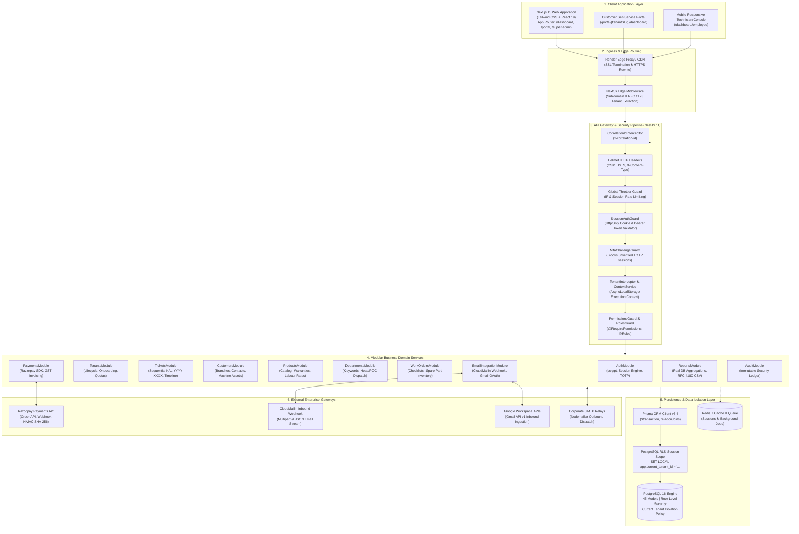
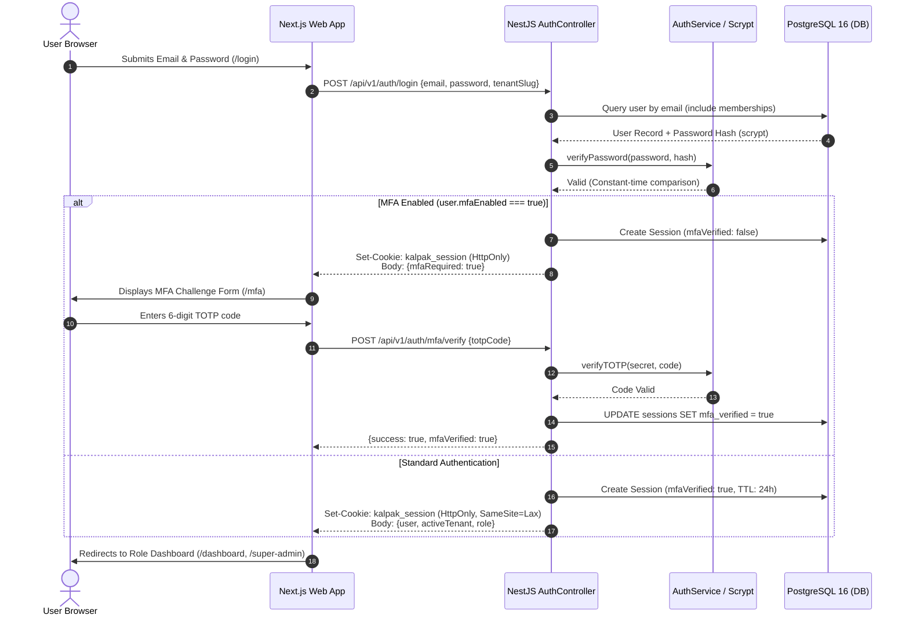

# Kalpak Solutions — Service Calls & Ticket Management System
## Technical Architecture & System Design Specification

**Document ID:** KALPAK-ARCH-002  
**Version:** 1.0.0  
**Date:** October 2026  
**Status:** Architecture Baseline  

---

## 1. Architectural Philosophy: The Service-Ready Modular Monolith

The Kalpak Solutions platform is architected as a **Modular Monolith** that is intentionally **Service-Ready**. 

In industrial B2B SaaS applications, premature physical microservices introduce severe complexities: distributed 2-phase commit transactions across database engines, cross-service network latency, data consistency bugs, and heavy deployment orchestration costs.

Instead, we enforce **strict physical and logical domain boundaries** within a unified, high-performance monorepo:
1. **Physical Boundary:** Modules are encapsulated under `apps/` and `packages/` workspaces managed by `pnpm`.
2. **Logical Boundary:** Domain services communicate strictly via exported TypeScript interfaces and dependency injection. Internal classes are never leaked across modules.
3. **Database Boundary:** Every tenant-owned table in PostgreSQL 16 contains a mandatory `tenant_id UUID` foreign key enforced by Row-Level Security (RLS).
4. **Service Extraction Readiness:** Any high-throughput domain module—such as `apps/worker` for background ticket SLA calculations, or `email-integration` for high-volume webhook ingestion—can be extracted into a standalone physical microservice with zero schema refactoring.

---

## 2. Comprehensive System Architecture Diagram



---

## 3. Request Flow & Execution Pipeline

Every inbound HTTP request traversing the Kalpak Solutions API passes through a strict sequential filter pipeline:

```
+-----------------------------------------------------------------------------------------+
|                                    INBOUND HTTP REQUEST                                 |
+-----------------------------------------------------------------------------------------+
                                             |
                                             v
1. CorrelationIdInterceptor: Attaches or generates a unique UUID (x-correlation-id)
   injected into Pino structured logs for distributed request tracing.
                                             |
                                             v
2. Helmet Security Headers: Sets X-Frame-Options: DENY, X-Content-Type-Options: nosniff,
   Strict-Transport-Security (HSTS), and Content Security Policy (CSP).
                                             |
                                             v
3. SubdomainResolver & Tenant Extraction: Checks hostname (e.g. acme-corp.kalpaksolutions.com)
   or explicit x-tenant-slug header to identify target tenant organization.
                                             |
                                             v
4. SessionAuthGuard: Extracts kalpak_session HttpOnly cookie or Authorization: Bearer token.
   Computes SHA-256 cryptographic digest of the token and queries sessions table in DB.
   Verifies expiry and revocation status.
                                             |
                                             v
5. MfaChallengeGuard: Inspects session.mfaVerified. If false, denies all endpoints
   except /auth/mfa/verify.
                                             |
                                             v
6. TenantInterceptor & AsyncLocalStorage: Resolves active tenant membership. Binds the
   tenant context to Node.js AsyncLocalStorage via TenantContextService.
                                             |
                                             v
7. PermissionsGuard & RolesGuard: Evaluates atomic @RequirePermissions() against active
   role permissions. Super Admin automatically bypasses application-level gates.
                                             |
                                             v
8. Controller Execution: NestJS ValidationPipe enforces class-validator and Zod schemas with
   whitelist: true and forbidNonWhitelisted: true.
                                             |
                                             v
9. Database Query Execution (Prisma + RLS): PrismaService executes:
   SET LOCAL app.current_tenant_id = '<active_tenant_id>';
   PostgreSQL RLS engine enforces tenant isolation directly inside the database.
                                             |
                                             v
+-----------------------------------------------------------------------------------------+
|                                   OUTBOUND JSON RESPONSE                                |
+-----------------------------------------------------------------------------------------+
```

---

## 4. Multi-Tenancy & Data Isolation (Defense-in-Depth)

Tenant isolation is an absolute non-negotiable security boundary. Under no circumstances may data belonging to Company A be exposed to Company B. 

We reject relying solely on application developers remembering `where: { tenantId }` in Prisma queries. Instead, we enforce a **4-tier Defense-in-Depth architecture**:

```
Layer 1: Identity Isolation
   Session token strictly binds the user to an authoritative activeTenantId.
   Client-supplied tenant IDs in URLs are always checked against session memberships.

Layer 2: Execution Context Propagation
   TenantInterceptor captures the resolved tenant and binds it to Node.js
   AsyncLocalStorage via TenantContextService. Tenant ID is injected into Pino logger.

Layer 3: Application Query Filter
   All repository services automatically inject tenantId from TenantContextService
   into Prisma insert, update, and find queries.

Layer 4: PostgreSQL Row-Level Security (RLS)
   PostgreSQL 16 kernel enforces isolation at the database disk and buffer cache layer.
   Even raw SQL injection (SELECT * FROM service_tickets) returns ONLY rows belonging
   to the active session tenant.
```

### 4.1 PostgreSQL Row-Level Security (RLS) Specification
* Foundational SQL: [`packages/database/prisma/rls.sql`](file:///c:/Kalpak_proj/packages/database/prisma/rls.sql)
* Helper Function:
  ```sql
  CREATE OR REPLACE FUNCTION current_tenant_id() RETURNS uuid AS $$
  BEGIN
      RETURN NULLIF(current_setting('app.current_tenant_id', true), '')::uuid;
  EXCEPTION
      WHEN OTHERS THEN RETURN NULL;
  END;
  $$ LANGUAGE plpgsql STABLE;
  ```
* Super Admin Bypass Function:
  ```sql
  CREATE OR REPLACE FUNCTION is_rls_bypassed() RETURNS boolean AS $$
  BEGIN
      RETURN current_setting('app.bypass_rls', true) = 'true';
  EXCEPTION
      WHEN OTHERS THEN RETURN false;
  END;
  $$ LANGUAGE plpgsql STABLE;
  ```
* Tenant-Level Security Policy (Applied to all 32 tenant-owned tables):
  ```sql
  CREATE POLICY service_tickets_tenant_isolation_policy ON service_tickets
      FOR ALL
      USING (
          is_rls_bypassed() = true
          OR tenant_id = current_tenant_id()
      )
      WITH CHECK (
          is_rls_bypassed() = true
          OR tenant_id = current_tenant_id()
      );
  ```

---

## 5. Authentication & Session Lifecycle

The platform uses stateful database-backed sessions with SHA-256 cryptographic hashing and `HttpOnly` cookies, avoiding the severe security and instant-revocation drawbacks of stateless JWTs.

### 5.1 Authentication Sequence Diagram



---

## 6. External Enterprise Integrations

### 6.1 Razorpay Payment Gateway & Dunning Lifecycle
* **SDK:** `razorpay@2.9.8` ([payments.service.ts](file:///c:/Kalpak_proj/apps/api/src/modules/payments/payments.service.ts))
* **Currency:** Indian Rupee (`INR`) with automated 18% Goods and Services Tax (GST) calculation.
* **Order Creation:** Endpoint `POST /api/v1/payments/create-order` creates a Razorpay order entity with unique metadata binding `tenant_id`, `plan`, and `billing_cycle`.
* **Webhook Verification:** Endpoint `POST /api/v1/payments/webhook` captures raw HTTP request body buffers. It validates the cryptographic signature using HMAC SHA-256 against `RAZORPAY_WEBHOOK_SECRET` before updating subscription records to `ACTIVE`.

### 6.2 Inbound Email-to-Ticket Conversion Pipeline
* **CloudMailin Inbound Relay:** Endpoint `POST /api/v1/email-integration/cloudmailin/incoming` receives parsed multipart MIME emails.
* **Tenant Identification:** Resolves customer tenant by matching recipient address (`support@tenant.kalpaksolutions.com`) against `EmailConfiguration` tables.
* **Intelligent Routing:** Analyzes subject lines and email body text against department keywords (e.g. *"PLC"*, *"motor"*, *"leakage"*, *"network"*) to automatically classify ticket priority and department assignment.
* **Idempotency Protection:** Detects duplicate incoming emails using standard RFC 2822 `Message-ID` headers to prevent ticket duplication.
